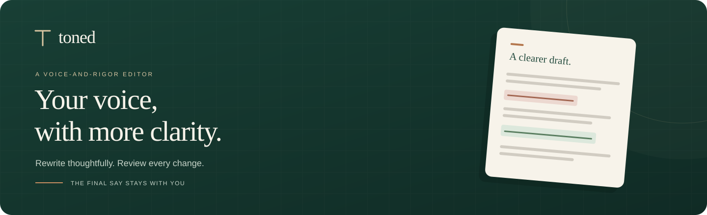
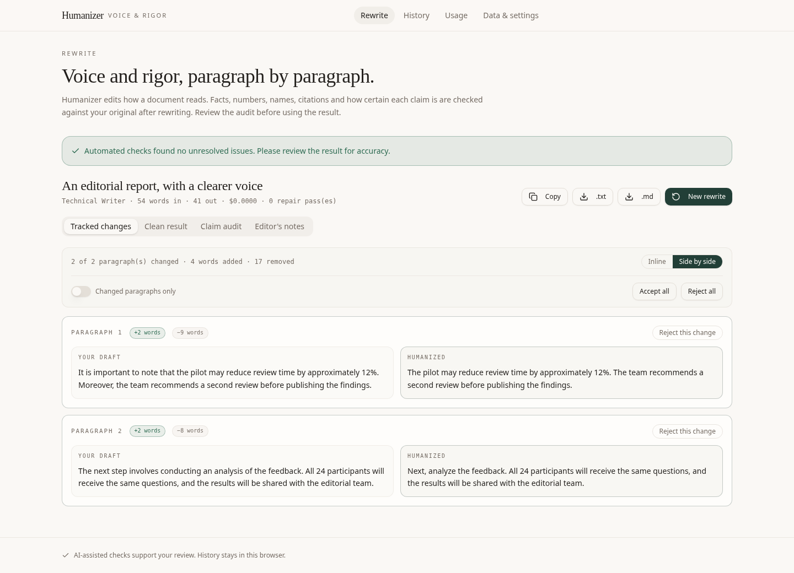
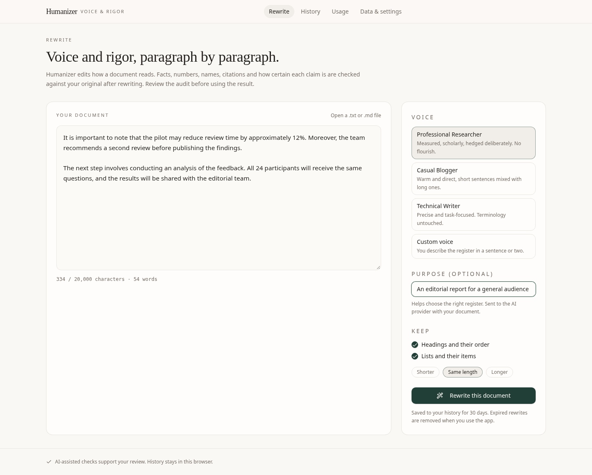
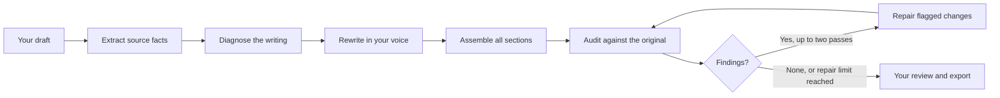

<p align="center">
  
</p>

<p align="center">
  <strong>Natural writing. Visible changes. A separate check against your original.</strong>
</p>

<p align="center">
  Turn a rough or AI-assisted draft into prose that sounds like you.<br />
  Choose a voice, review the rewrite, and decide what makes the final cut.
</p>

<p align="center">
  <a href="https://github.com/ambreenprimeline-oss/toned-ai-humanizer/actions/workflows/checks.yml"></a>
  <a href="ai-humanizer/.nvmrc"></a>
  <a href="ai-humanizer/README.md#data-and-privacy"></a>
</p>

<p align="center">
  <a href="https://ai-humanizer-pearl.vercel.app/"><strong>Try Toned ↗</strong></a> &nbsp;·&nbsp;
  <a href="#the-editor">Product tour</a> &nbsp;·&nbsp;
  <a href="#quick-start">Run locally</a> &nbsp;·&nbsp;
  <a href="#launch-on-vercel">Deploy</a> &nbsp;·&nbsp;
  <a href="ai-humanizer/README.md">Developer guide</a> &nbsp;·&nbsp;
  <a href="https://github.com/ambreenprimeline-oss/toned-ai-humanizer/issues">Feedback</a>
</p>

---

## A better draft should still be your draft

A sentence can sound smoother and say something different. A number gets rounded. A quotation gets reworded. “May” quietly becomes “will.”

**Toned gives you a way to review those changes.** It rewrites in your chosen voice, compares the result with your original, and brings unresolved findings into view. You get the rewrite, the tracked changes, the claim audit, and the final decision.

Built for researchers polishing a paper, technical writers refining documentation, bloggers finding their voice, and anyone reviewing an AI-assisted draft before publishing.

## The editor

<p align="center">
  
</p>

*Actual interface with illustrative sample text and review data. This is a product walkthrough, not a live model benchmark.*

### From a first draft to a considered final version

| | What you can do |
| --- | --- |
| **Choose your voice** | Use Professional Researcher, Casual Blogger, Technical Writer, or describe a custom voice. Add context about your audience or purpose. |
| **Keep the structure you need** | Request shorter, similar-length, or longer prose, with controls for headings and lists. |
| **See what changed** | Read word-level markup inline or compare passages side by side. Accept or reject individual changes, show changed passages only, or apply a choice across the document. Structural edits can group several paragraphs into one review choice. |
| **Inspect the audit** | Review findings about claims, numbers, names, citations, quotations, certainty, and formatting. Added or missing information stays visible. |
| **Take your work with you** | Copy the result or download `.txt` and `.md` files. Revisit saved rewrites, audits, and editor’s notes in History. |
| **Choose what gets saved** | Keep history for 7, 30, or 90 days, or keep a rewrite in page memory only. Delete individual rewrites or clear local history. |

<details>
<summary><strong>See the writing workspace</strong></summary>

<br />



*The editor accepts pasted text and `.txt`, `.md`, or `.markdown` files. Rewriting supports up to 20,000 input characters.*

</details>

## A small edit. The same level of certainty.

| Before | After |
| --- | --- |
| It is important to note that the pilot may reduce review time by approximately 12%. | The pilot may reduce review time by approximately 12%. |

Less throat-clearing. The same **“may,” “approximately,” and “12%.”** That is the kind of edit Toned is designed to make—and the kind of preservation its checks are designed to review.

*Illustrative editing example. Actual output depends on your document, instructions, and configured model.*

## How a rewrite gets reviewed



1. **Establish the source.** Identify claims, exact values, names, citations, quotations, and uncertainty markers.
2. **Plan the edit.** Look for repetitive phrasing, uniform rhythm, stock transitions, and other habits that make prose feel mechanical.
3. **Rewrite in sections.** Apply your voice and formatting preferences with section-specific source facts and context from preceding sections.
4. **Check the result separately.** Compare the full original and rewrite in another model pass, supplemented by deterministic checks. The audit does not receive the rewrite plan.
5. **Repair, then check again.** Attempt up to two repair passes. Findings that remain produce **Needs review** rather than disappearing behind a success message.
6. **Make the final call.** Inspect the changes, keep the passages you want, and export your text. Review choices are saved with your local history.

The audit checks consistency with your source; it does not verify that the source itself is true. Automated checks can miss errors. If you reject changes after the audit, review that final combination again before sharing it.

## Four voices, one draft

| Voice | Best suited to | Direction |
| --- | --- | --- |
| **Professional Researcher** | Papers, reports, analytical prose | Measured language, precise claims, deliberate uncertainty. |
| **Casual Blogger** | Articles, newsletters, personal writing | Warm, direct prose with varied sentence length. |
| **Technical Writer** | Documentation, guides, explanations | Clear instructions, consistent terminology, task-focused writing. |
| **Custom voice** | Your own audience and house style | Describe the register, rhythm, and phrasing you want. |

## Quick start

**Requirements:** Node.js **22 or 24**, npm, and an **OpenRouter key** for the default free-only mode.

```bash
git clone https://github.com/ambreenprimeline-oss/toned-ai-humanizer.git
cd toned-ai-humanizer/ai-humanizer
npm ci
cp .env.example .env.local
```

Enter `OPENROUTER_API_KEY_1` in the ignored `.env.local` file, or inject it through secure environment settings. The default `AI_PROVIDER_MODE=free` uses `openrouter/free` for rewriting and audits, with no paid fallback. Never put credentials in a `VITE_` variable.

```bash
npm run dev
```

Use the address printed by Vite. The development server runs the interface and the real API handlers together. Restart it after changing environment variables.

No account, database for document history, or separate backend process is needed for local development. Free-tier availability and rate limits apply. Potentially paid models require explicit configured-mode opt-in; hosting and Redis have their own plans and limits.

### Free-only by default

Toned defaults to OpenRouter's **`openrouter/free`** route for both model tiers. The provider catalog reports zero prompt/completion pricing for this route. Optional `OPENROUTER_FREE_MODEL` overrides must use `openrouter/free` or an ID ending in `:free`. Paid model overrides and other providers are disabled in this mode.

Free does not mean unlimited: the provider can rate-limit requests or run out of capacity. Production request limits still apply.

### Optional provider configuration

Setting **`AI_PROVIDER_MODE=configured`** explicitly enables the following provider choices and potentially paid model routes:

| Provider | Primary server credential | Additional setup |
| --- | --- | --- |
| **Google** | `GOOGLE_API_KEY` | Model overrides available for fast and quality stages. |
| **OpenRouter** | `OPENROUTER_API_KEY_1` | Access depends on the models enabled for your account. |
| **SambaNova** | `SAMBANOVA_API_KEY_1` | Configure model overrides if needed. |
| **Cloudflare Workers AI** | `CLOUDFLARE_API_KEY_1` | Also requires `CLOUDFLARE_ACCOUNT_ID`. |

In configured mode, configure one provider or several. Optional second and third keys support rotation within a running server instance. Calls have bounded retries and can fall back to another configured provider within the attempt budget.

See the [provider configuration guide](ai-humanizer/README.md#provider-configuration) for model defaults, aliases, destinations, and timeouts.

## Launch on Vercel

Import this repository into Vercel and set the **Root Directory** to **`ai-humanizer`**. The included configuration defines the Vite build, API functions, SPA routing, and response headers.

Before opening the deployment to users:

1. **Add `OPENROUTER_API_KEY_1`** in Vercel’s server environment settings and keep `AI_PROVIDER_MODE=free`, or explicitly choose configured mode and its provider credentials. Cloud development settings do not automatically configure a deployment.
2. **Configure shared request limits** with `UPSTASH_REDIS_REST_URL` and `UPSTASH_REDIS_REST_TOKEN` from a dedicated Upstash database. The token needs EVAL permissions. Production and preview deployments require this shared limiter.
3. **Set a usage budget.** Defaults allow 60 stage requests per client per 10 minutes and 1,000 globally per UTC day. A document uses multiple stage requests. Review those limits and your provider’s billing controls for your expected traffic.
4. **Run the checks**, then exercise a representative rewrite using your actual provider credentials and inspect its audit.
5. **Verify the deployed experience**, including direct page routes, exports, missing-service messages, and rate-limit behavior.

`/api/health` reports whether configuration is present. It does not validate a provider key, model availability, Redis connectivity, or writing quality. Production billable requests fail closed when the shared limiter is missing or unavailable.

**[Read the full deployment guide →](ai-humanizer/README.md#production-deployment)**

## Clear about your text

- **History stays in this browser.** It uses `localStorage`, with no account or cross-device synchronization.
- **AI processing uses an external provider.** Document text and relevant instructions travel through the API to your configured provider. Its data policies apply.
- **No-history mode keeps the job in page memory.** Closing or leaving the page loses that temporary result. This does not control the provider’s retention.
- **Retention runs when you use the app.** Expired browser history is removed on access; no purge runs while the site is closed.
- **Local deletion removes local copies.** Clearing history does not delete records independently retained by hosting or AI services.

Toned supports editorial work. It does not promise detector scores, undetectability, or guaranteed factual accuracy, and it declines requests explicitly intended to deceive an academic assessor.

## Under the hood

| Layer | Technology |
| --- | --- |
| Interface | React 18, Vite, Tailwind CSS, Radix UI |
| Server | Node.js functions on Vercel |
| Model integration | Google, OpenRouter, SambaNova, Cloudflare Workers AI |
| Contracts and checks | Zod schemas, source IDs, fingerprints, deterministic comparisons |
| Document history | Browser `localStorage`; memory-only jobs when history is disabled |
| Production request limits | Upstash Redis with atomic per-client and daily counters |
| Verification | ESLint, Node’s test runner, Playwright, GitHub Actions |

```text
.
├── README.md                  Product overview
├── docs/assets/               Brand artwork and interface screenshots
├── .github/workflows/         Automated application checks
└── ai-humanizer/
    ├── src/                   Editor, review tools, history, and settings
    ├── api/                   Rewrite stages, providers, health, and request limits
    ├── scripts/               Local API adapter
    ├── tests/                 Regression tests
    ├── e2e/                   Browser workflow tests
    └── README.md              Configuration and deployment reference
```

### Verify a change

From `ai-humanizer/`:

```bash
npm run check          # lint, regression tests, production build
npm run test:e2e       # browser workflows with mocked provider responses
```

Browser tests need Chromium. Install it with `npx playwright install chromium`, or use an installed browser through `PLAYWRIGHT_CHROMIUM_EXECUTABLE_PATH`. CI installs its own browser.

Automated fixtures exercise the workflow and its failure paths; they do not measure live model accuracy. Usage cost figures in the app are rough estimates, not provider invoices or subscription prices.

## Feedback that makes the editor better

Found an awkward rewrite, a missed factual change, or a confusing interaction? [Open an issue](https://github.com/ambreenprimeline-oss/toned-ai-humanizer/issues/new) with steps to reproduce, the behavior you expected, and a short, non-sensitive example where possible. Keep credentials and private documents out of issue reports.

<p align="center">
  <br />
  <strong>Write like yourself. Stay true to your meaning.</strong><br />
  <a href="https://ai-humanizer-pearl.vercel.app/">Try Toned ↗</a> &nbsp;·&nbsp;
  <a href="#quick-start">Start locally</a> &nbsp;·&nbsp;
  <a href="ai-humanizer/README.md">Read the developer guide</a>
</p>
